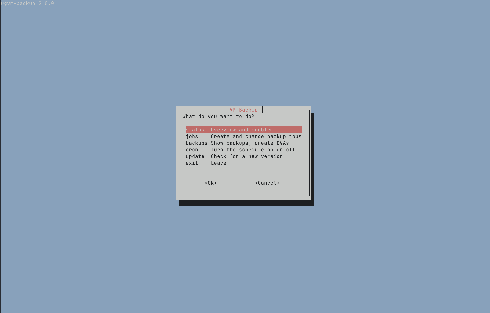
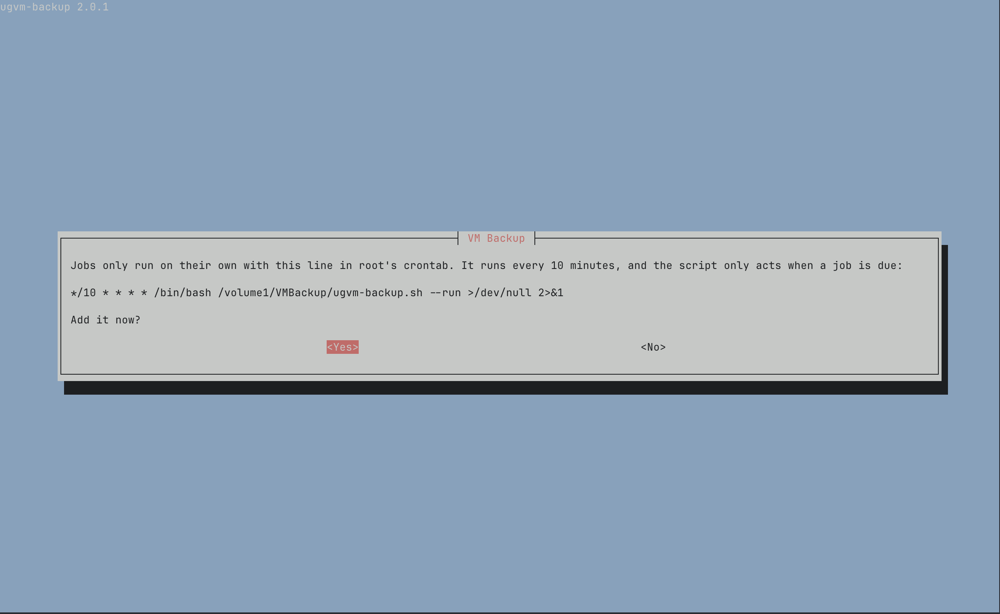
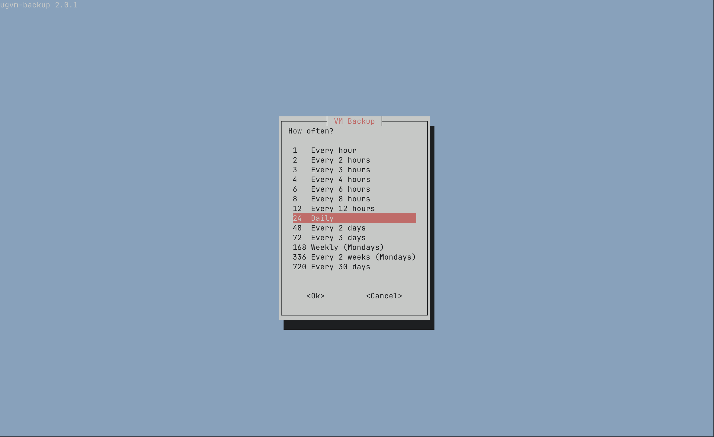

# VM Backup for UGOS

Live backups of the VMs on a UGREEN NAS, from one script with a simple terminal interface. Running VMs are never shut down.



This is an independent project and is not affiliated with UGREEN.

## Install

Create a shared folder for your backups, for example `VMBackup` on Volume 1. Then connect to the NAS over SSH and run:

```bash
curl -fsSL https://raw.githubusercontent.com/cutzenfriend/ugos-vm-backup/main/ugvm-backup.sh -o /volume1/VMBackup/ugvm-backup.sh && sudo bash /volume1/VMBackup/ugvm-backup.sh
```

This downloads the script and opens the interface. If your folder has a different path, change it in both places.

In the interface:

1. Confirm the schedule when the script asks. It adds one line to root's crontab, which runs every 10 minutes, and only acts when a job is due. The script checks this on every start, and the main menu shows whether the schedule is active.
2. **jobs** > **Create a job:** choose the VMs, the schedule and how long backups are kept.



To open the interface again:

```bash
sudo bash /volume1/VMBackup/ugvm-backup.sh
```

## Requirements

- UGOS with SSH access and an administrator account
- VM disks on a btrfs volume, without `nodatacow`
- `qemu-guest-agent` running inside each VM you back up while it runs
- `whiptail` and `curl`, which were already on the NAS this was tested on

`--check` shows whether your NAS and VMs meet these requirements, and how much space is left. It changes nothing. The main menu says whether all VMs are ready for live backups, the status page shows the details, and saving a job warns about VMs that can't be backed up while they run.

```bash
sudo bash /volume1/VMBackup/ugvm-backup.sh --check
```

## How a backup works

1. The guest agent freezes the file systems inside the VM.
2. btrfs clones the disk, which takes a moment because no data is copied yet.
3. The VM continues.
4. The script copies the clone to the backup folder, checks the copy and deletes the clone.

A powered-off VM is copied directly. If a running VM can't be frozen or its disk can't be cloned, the job fails with an error. The script doesn't fall back to copying a disk in use, because that can produce a damaged backup.

A frozen backup is as clean as a file system after a sync. Databases inside the VM may run their normal recovery when restored.

Copies run with the lowest CPU and disk priority, so other services on the NAS keep their speed. A backup takes longer when the NAS is busy.

## Files

Everything stays in one folder:

```text
/volume1/VMBackup/
├── ugvm-backup.sh
├── config.ini
├── ugvm-backup.log
├── ugvm-state/
└── MyVM-1a2b3c4d/
    └── backup-<job>-<time>/
        ├── sda.qcow2
        ├── domain.xml
        ├── manifest.txt
        ├── nvram.fd            if the VM uses UEFI
        ├── tpm-state.tar.gz    if the VM has a TPM
        └── vm.ova              only if you created one
```

A backup folder only gets its final name once the copy is complete and checked.

## Jobs

| Type | What you get |
|---|---|
| Backup | A full copy of the disks and the VM definition |
| Snapshot | A snapshot inside the VM disk, named like those UGOS creates. It doesn't protect against drive failure. |

**Retention:** The count and age limits both apply, and 0 means no limit. The newest backup is never deleted, and nothing is deleted after a failed run. Only backups from the same job count, so snapshots you create manually in UGOS are left alone.

**Compression:** Each backup job can compress its backups with zstd. This saves space, especially for disks with a lot of text or free space, but copying takes longer.

**Schedule:** A new job first runs at its next scheduled time. After a failure, the next attempt comes an hour later at the earliest.



## Restoring

**As a new VM:** Under **backups**, choose a backup and then **Create OVA for importing**. Import `vm.ova` in the Virtual Machine app. Disconnect the network before the first start if the original VM is still running, because the copy has the same hostname and services.

**Over the existing VM:** Under **backups**, choose a backup and then **Put this backup back onto the VM**. The script:

1. Checks the backup and the free space while the VM keeps running.
2. Shuts the VM down if it is running. Restoring is the one action that has to.
3. Moves the current disks aside, copies the backup in their place and restores the UEFI variables.
4. Starts the VM again if it was running.

The previous disks stay next to the new ones with the ending `.before-restore-<time>` until you delete them. If anything fails, the previous disks are put back. The script refuses to restore a VM that has snapshots, because they would no longer work, so delete them in UGOS first or import an OVA as a new VM instead.

## Commands

| Command | What it does |
|---|---|
| `--run` | Runs what is due, for cron |
| `--now JOB` | Runs one job immediately |
| `--ova BACKUP_DIR` | Creates an OVA from a backup, even if the VM no longer exists |
| `--restore BACKUP_DIR [--yes]` | Puts a backup back onto its VM |
| `--check` | Shows what the script finds on this NAS |
| `--update [--yes]` | Updates the script from GitHub |
| `--version` | Shows the version |

## Updating

When the interface starts, it checks GitHub for a newer version and shows it in the main menu. **update** installs it after you confirm. Cron never updates the script. The previous version stays next to it as `ugvm-backup.sh.previous`.

## Security

- The script runs as root from cron, so only people you trust as root should be able to write to its folder.
- `config.ini` is only read as data and is never executed. Invalid values are rejected.
- The disk format always comes from the VM definition, so a VM can't pull host files into a backup through a crafted disk.
- Updates come from this repository over HTTPS and aren't signed.

## Removing

1. Under **cron**, turn off the schedule.
2. Delete `ugvm-backup.sh`, `config.ini`, `ugvm-backup.log` and `ugvm-state` from the folder. Your backups are the folders next to them.

## Development

The tests run in a disposable Debian 12 container and also drive the real `whiptail` in a pseudo terminal:

```bash
bash tests/run-in-docker.sh
```

When you change the script, increase `VERSION` at the top of it. Otherwise `--update` won't offer the change to anyone.

## License

Released under the [MIT License](LICENSE).
